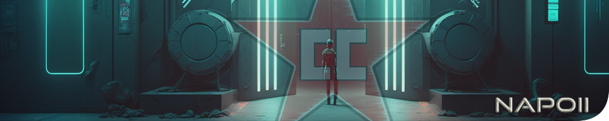

<p align="center">
<a href="https://github.com/NapoII">
    
</a>
</p>

<center>

# EFT-Bots
</center>

<p align="center">
<a href="https://github.com/NapoII/EFT-Bots/archive/refs/heads/main.zip">
    
</a>

<a href="https://github.com/NapoII/EFT-Bots/archive/refs/heads/main.zip">
    
</a>

<a href="https://github.com/NapoII/EFT-Bots/blob/main/LICENSE">
    
</a>

<a href="https://github.com/NapoII/EFT-Bots/actions">
    
</a>

<a href="https://github.com/NapoII/EFT-Bots/issues">
    
</a>

<a href="https://github.com/NapoII/EFT-Bots/stargazers">
    
</a>

<a href="https://discord.gg/g7EW4P65">
    
</a>
</p>

### EFT - Best_Bullets
This program is designed to identify which bullets are good and which ones are bad in the Tarkov inventory menu. It does this by retrieving data from an API using an API key and a URL, and then downloads and saves images of the items locally. It also reads data from a text file and converts it into a list.

### EFT - Take_Best_bullets
This is a Python script that automates a process in the game Escape from Tarkov. The script uses image recognition to identify and select certain types of ammunition in the player's inventory. The ammunition is categorized into two lists - "Low_Ammo_List" and "High_Ammo_List" - based on their perceived quality. The user is prompted to input a hotkey to start the script. Once activated, the script continuously scans the player's inventory for the specified types of ammunition and automatically selects them for the player. The script ends when all items on both lists have been collected.

### EFT-Ammo_Fill
The script appears to be an automation script that fills a certain number of magazines with ammunition based on user-defined settings. The script is written in Python and uses several libraries such as os, sys, pyautogui, and keyboard.

The script starts by setting up the directories for the log files, images, and documents. Then, it prompts the user for input regarding the number of magazines to fill, the size of the slots, the size of the magazines, the number of different types of bullets, and the bullet rhythm.

Afterward, the script sets up the positions for the slots, magazines, and bullets. It then calculates the number of bullets required to fill all the magazines and sets up a hotkey to start the script.

The main loop of the script consists of filling the magazines with ammunition. The script moves the mouse cursor to the correct positions, clicks the left mouse button, and moves the cursor to another position to simulate drag and drop functionality. This process continues until all the magazines are filled with the required amount of ammunition.

The script also checks for errors during the process by comparing screenshots of the game's user interface with predefined images. The script also logs the progress and errors to a text file.

###EFT-AutoBuy
The program is designed to help players of the game Tarkov earn a profit by buying and reselling items on the in-game flea market. The program automates the process of searching for specific items and finding good deals on them, allowing the player to quickly buy and resell items for a higher price.

To use the program, the player inputs a list of items they want to search for and sets a desired profit margin. The program then searches the flea market for those items and identifies listings that are priced lower than their market value. The player can then choose which items to buy and the program will automatically purchase them at the lowest available price.

Once the items are purchased, the program can then automatically list them for sale at a higher price, based on the desired profit margin. The program can also keep track of the items already purchased and automatically relist them when they expire, ensuring a steady stream of income.

Overall, the program helps players of Tarkov efficiently search for and purchase items for a low price, and then resell them for a profit on the in-game flea market. This can greatly enhance the player's ability to accumulate wealth and acquire rare items in the game.
## Running Locally

This application requires Python 3.10.7.
```
git clone https://github.com/NapoII/EFT-Bots
pip install -r requirements.txt
run Code EFT-Bots.py
```

## Example
coming soon...
## Lizenz

MIT License

Copyright (c) 2023 NapoII
<small><small><small>
Permission is hereby granted, free of charge, to any person obtaining a copy
of this software and associated documentation files (the "Software"), to deal
in the Software without restriction, including without limitation the rights
to use, copy, modify, merge, publish, distribute, sublicense, and/or sell
copies of the Software, and to permit persons to whom the Software is
furnished to do so, subject to the following conditions:

The above copyright notice and this permission notice shall be included in all
copies or substantial portions of the Software.

THE SOFTWARE IS PROVIDED "AS IS", WITHOUT WARRANTY OF ANY KIND, EXPRESS OR
IMPLIED, INCLUDING BUT NOT LIMITED TO THE WARRANTIES OF MERCHANTABILITY,
FITNESS FOR A PARTICULAR PURPOSE AND NONINFRINGEMENT. IN NO EVENT SHALL THE
AUTHORS OR COPYRIGHT HOLDERS BE LIABLE FOR ANY CLAIM, DAMAGES OR OTHER
LIABILITY, WHETHER IN AN ACTION OF CONTRACT, TORT OR OTHERWISE, ARISING FROM,
OUT OF OR IN CONNECTION WITH THE SOFTWARE OR THE USE OR OTHER DEALINGS IN THE
SOFTWARE
</small>
